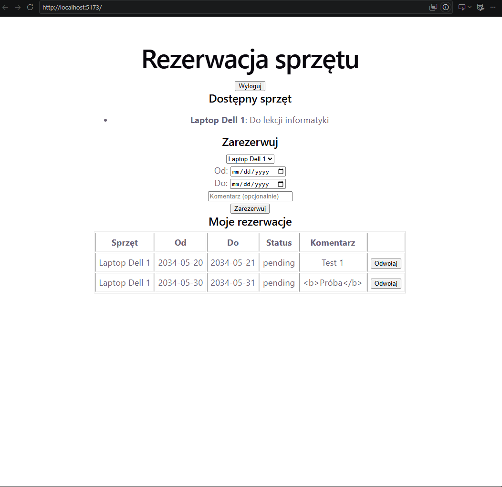

# Rezerwacja sprzętu szkolnego

## Autor
Michał Węglarczyk (projekt indywidualny)

## Cel aplikacji
Aplikacja jest dla uczniów oraz opiekuna pracowni. Rozwiązuje problem papierowych
list i ustnych umówień, przez które sprzęt (laptopy, projektory, aparaty) bywa
zarezerwowany przez dwie osoby naraz albo ginie bez śladu.

Przykład użycia: uczeń loguje się, wybiera laptop, rezerwuje go na wybrany termin,
a opiekun pracowni zatwierdza rezerwację.

## Funkcje
1. Uczeń rejestruje się i loguje do aplikacji.
2. Uczeń przegląda listę sprzętu.
3. Uczeń rezerwuje sprzęt na termin (data od - do) i może dodać komentarz.
4. Uczeń widzi swoje rezerwacje i może odwołać wybraną z nich.
5. Opiekun widzi wszystkie rezerwacje i zatwierdza lub odrzuca oczekujące.
6. Opiekun dodaje sprzęt do listy.

## Technologie i dane
- Interfejs: React (Vite)
- Serwer: Node.js + Express (REST API)
- Baza danych: SQLite (plik `backend/rezerwacje.db`), obsługiwana przez serwer
  za pomocą wbudowanego modułu `node:sqlite`
- Hasła: haszowane (bcrypt), logowanie przez token JWT (ważny 2 godziny)

## Uruchomienie na innym komputerze

### Wymagania
- Git
- Node.js **24 LTS** (moduł `node:sqlite` wymaga wersji 22.13 lub nowszej)

Na Windowsie w PowerShellu może być potrzebne jednorazowe odblokowanie skryptów:
`Set-ExecutionPolicy -Scope CurrentUser -ExecutionPolicy RemoteSigned`

### Instalacja
```
git clone https://github.com/weglarczykmichal/rezerwacja-sprzetu.git
cd rezerwacja-sprzetu
```

### Serwer (terminal 1)
```
cd backend
npm install
```
Utwórz plik `backend/.env` (nie ma go w repozytorium) z jedną linijką:
```
JWT_SECRET=wpisz-tu-dlugi-losowy-tekst-minimum-32-znaki
```
Uruchom:
```
node index.js
```
Serwer działa na `http://localhost:3001`. Baza tworzy się sama przy pierwszym
uruchomieniu. Może pojawić się ostrzeżenie `ExperimentalWarning: SQLite`, można je pominąć.

### Interfejs (terminal 2)
```
cd frontend
npm install
npm run dev
```
Aplikacja jest dostępna pod adresem `http://localhost:5173`.

### Konta testowe
Konta uczniów zakłada się przez formularz rejestracji. Konto opiekuna (admina)
nadaje się ręcznie w bazie, żeby nikt nie mógł sam sobie nadać uprawnień:
1. Zarejestruj konto, np. `admin@test.pl` (hasło min. 8 znaków).
2. W folderze `backend` wpisz: `node make-admin.js admin@test.pl`
3. Zaloguj się na to konto i dodaj sprzęt w panelu opiekuna.

## Zagrożenia i zabezpieczenia

| Zagrożenie | Zabezpieczenie |
|---|---|
| Uczeń odwołuje cudzą rezerwację (zmiana ID w żądaniu) | Serwer porównuje właściciela rezerwacji z użytkownikiem z tokenu |
| Uczeń wykonuje operację opiekuna | Serwer sprawdza rolę przy każdej takiej operacji (`adminRequired`) |
| Błędne dane (data końca przed początkiem, zły format) | Walidacja po stronie serwera |
| Kod HTML/JS w komentarzu | React wyświetla treść jako zwykły tekst |
| Wstrzyknięcie SQL | Zapytania parametryzowane (`?`) |
| Wyciek haseł i sekretów | Hasła haszowane bcryptem, sekrety w `.env` poza repozytorium |
| Podwójna rezerwacja sprzętu | Serwer sprawdza dostępność terminu przed zapisem |

## Testy zabezpieczeń

Testy wykonano na własnej aplikacji, na kontach testowych: dwóch uczniów
(`test@test.pl`, `uczen2@test.pl`) i opiekun (`admin@test.pl`).
Żądania wysyłano bezpośrednio do serwera (PowerShell), z pominięciem interfejsu.

### Test 1: kontrola dostępu do danych
**Co sprawdziłem:** uczeń 2 próbuje odwołać rezerwację ucznia 1 (`DELETE /api/reservations/1`).
**Wynik:** serwer odpowiedział kodem **403** `{"error":"To nie jest Twoja rezerwacja"}`.
Status rezerwacji przed próbą i po niej: `pending`. Rezerwacja pozostała bez zmian.

### Test 2: walidacja po stronie serwera
**Co sprawdziłem:** wysłałem rezerwację z datą końca wcześniejszą niż początku
(koniec 2034-06-14, początek 2034-06-19), z pominięciem formularza.
**Wynik:** serwer odpowiedział kodem **400**
`{"error":"Data końca nie może być wcześniejsza niż początku"}`. Rezerwacja nie została zapisana.

### Test 3: wyświetlanie treści użytkownika
**Co sprawdziłem:** zapisałem komentarz `<b>Próba</b>` do rezerwacji.
**Wynik:** serwer zapisuje i zwraca tekst bez zmian, a interfejs wyświetla go
**dosłownie** (ze znacznikami, bez pogrubienia), bo React traktuje treść jako tekst.
W tabeli widać dosłownie tekst <b>Próba</b>, bez pogrubienia



### Test 4: ochrona funkcji administratora
**Co sprawdziłem:** uczeń wysyła żądanie zatwierdzenia rezerwacji
(`PATCH /api/admin/reservations/1`, status `approved`).
**Wynik:** serwer odpowiedział kodem **403** `{"error":"Brak uprawnień"}`.
Status rezerwacji w widoku opiekuna po próbie: nadal `pending`.

## Plan pracy (wykonany)
1. Konfiguracja projektu, repozytorium i README
2. Logowanie, rejestracja i lista sprzętu
3. Rezerwowanie i odwoływanie rezerwacji
4. Panel opiekuna (zatwierdzanie, dodawanie sprzętu)
5. Zabezpieczenia i testy
6. Dokumentacja i prezentacja